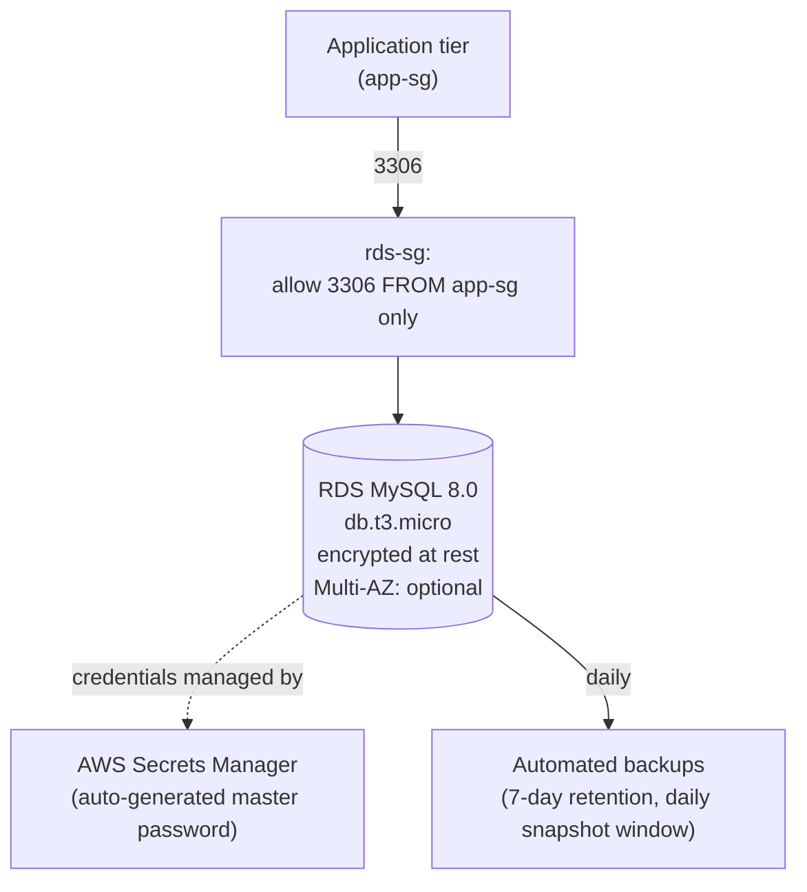

# AWS RDS Database Lab

A private, encrypted **Amazon RDS for MySQL** instance with automated backups and AWS-managed master credentials (via Secrets Manager — no password ever written to code, state output, or this repo), plus a head-to-head comparison with **DynamoDB** for when a managed relational database is (and isn't) the right call. Built while studying the database portion of the **AWS Certified Cloud Practitioner (CLF-C02)** exam.

> ⚠️ **Status**: this Terraform configuration was hand-written against the AWS provider docs and reviewed manually; `terraform validate`/`apply` have **not** been run — this environment has no Terraform CLI or AWS credentials. Run it yourself following [Setup](#setup). **Multi-AZ is not Free-Tier eligible** — see [Cost considerations](#cost-considerations).

## Table of contents
- [Learning objectives](#learning-objectives)
- [Use case](#use-case)
- [Architecture](#architecture)
- [RDS vs. DynamoDB](#rds-vs-dynamodb)
- [Why these services](#why-these-services)
- [Repository structure](#repository-structure)
- [Setup](#setup)
- [Testing](#testing)
- [Cleanup](#cleanup)
- [Cost considerations](#cost-considerations)
- [Security notes](#security-notes)
- [Troubleshooting](#troubleshooting)
- [Limitations & future improvements](#limitations--future-improvements)
- [References](#references)

## Learning objectives

After working through this lab you should be able to:
- Explain what RDS manages for you (patching, backups, failover) versus what you're still responsible for (schema design, query performance, instance sizing).
- Explain **Multi-AZ** (synchronous standby for failover, same region) vs. **Read Replicas** (asynchronous, for read scaling, can cross region) — a very common exam confusion.
- Explain automated backups vs. manual snapshots, and what "backup retention period" actually controls.
- Decide, for a given workload, whether RDS (relational, ACID, joins, fixed-ish schema) or DynamoDB (key-value/document, massive scale, single-digit-millisecond at any throughput, flexible schema) is the better fit.
- Explain why you should never hardcode a database password in application code or Terraform, and what AWS gives you instead (Secrets Manager-managed master password, in this lab).

## Use case

A small application needs a relational database for structured data with relationships (e.g. orders referencing customers) and needs ACID transactions. It must not be reachable from the public internet, its credentials must never appear in source control, and it needs automated daily backups with a sensible retention window.

## Architecture



RDS sits in a **DB subnet group** spanning two Availability Zones (using two subnets from the account's default VPC, for simplicity — see [Limitations](#limitations--future-improvements) on using a real private subnet instead) and is **not publicly accessible**; only the `app-sg` security group can reach it on port 3306.

## RDS vs. DynamoDB

| | **RDS** (this lab: MySQL) | **DynamoDB** |
|---|---|---|
| Data model | Relational — tables, foreign keys, joins | Key-value / document — no joins |
| Schema | Mostly fixed, defined up front | Flexible, per-item |
| Transactions | Full ACID, multi-row/table | ACID per-item and limited multi-item transactions |
| Scaling | Vertical (bigger instance) + read replicas; manual | Virtually unlimited, horizontal, automatic (on-demand or provisioned) |
| Latency at scale | Can degrade without tuning (indexes, query plans) | Single-digit-millisecond, consistently, at any scale |
| Operational model | You pick instance size, storage, patch windows | Fully serverless — no instances to manage at all |
| Pricing | Per instance-hour + storage + backup | Per request (on-demand) or provisioned capacity + storage |
| Good fit for | Reporting, complex queries, strong relationships, existing SQL tooling | High-throughput key lookups, session stores, leaderboards, IoT data, serverless apps |

**Rule of thumb for the exam**: if the question describes joins, complex queries, or "an existing application using SQL," the answer is RDS (or Aurora). If it describes massive, unpredictable scale with simple access patterns ("get this item by ID"), the answer is DynamoDB.

## Why these services

| Service | Why it was chosen |
|---|---|
| **RDS (MySQL)** | Fully managed patching, backups, and (optional) Multi-AZ failover — without running your own MySQL server. |
| **Secrets Manager (via RDS-managed master password)** | Removes the database password from Terraform state outputs, source control, and application config entirely — AWS generates and rotates it. |
| **DB subnet group across 2 AZs** | Required by RDS even for a single-AZ instance, and is what makes Multi-AZ failover possible later with zero migration. |
| **Security group scoped to `app-sg`** | Only the application tier — never the internet, never "my IP" left stale in a security group — can reach the database. |

## Repository structure

```
aws-rds-database-lab/
├── README.md
├── LICENSE
├── .gitignore
└── terraform/
    ├── main.tf               # VPC lookup, subnet group, security groups, RDS instance
    ├── variables.tf
    ├── outputs.tf
    └── terraform.tfvars.example
```

## Setup

**Prerequisites**: AWS account, [Terraform](https://developer.hashicorp.com/terraform/install) ≥ 1.5, AWS CLI v2 configured.

```bash
cd terraform
cp terraform.tfvars.example terraform.tfvars
# edit terraform.tfvars if you want to change the region, engine version, or enable multi_az

terraform init
terraform fmt -check
terraform validate
terraform plan
terraform apply   # takes several minutes — RDS instance creation is slow
```

No password is set anywhere in this configuration: `manage_master_user_password = true` tells RDS to generate one and store it in **AWS Secrets Manager**, scoped to this instance.

## Testing

1. `terraform output secret_arn` to get the Secrets Manager ARN holding the generated master credentials.
2. Retrieve the password **without ever printing it to Terraform state or this repo**:
   ```bash
   aws secretsmanager get-secret-value --secret-id <secret_arn> --query SecretString --output text
   ```
3. From an EC2 instance **inside the same VPC** with the `app-sg` security group attached (e.g. reuse the pattern from [`aws-iam-least-privilege-lab`](https://github.com/bboysendo/aws-iam-least-privilege-lab)), connect:
   ```bash
   mysql -h <rds_endpoint> -u admin -p
   ```
4. Confirm the **negative** case: from your own machine (not in the VPC / not in `app-sg`), the same connection attempt should time out — RDS is not publicly accessible and the security group doesn't allow it.
5. `aws rds describe-db-instances --db-instance-identifier <id> --query 'DBInstances[0].{BackupRetention:BackupRetentionPeriod,Encrypted:StorageEncrypted,MultiAZ:MultiAZ}'` to confirm backups, encryption, and Multi-AZ are configured as expected.

## Cleanup

```bash
cd terraform
terraform destroy   # type "yes" to confirm — this lab sets skip_final_snapshot = true, so no snapshot is kept
```

If you want to keep a snapshot for later, set `skip_final_snapshot = false` and `final_snapshot_identifier` **before** destroying — once destroyed without one, the data is gone.

## Cost considerations

- **`db.t3.micro`, single-AZ, 20 GB gp3 storage**: Free-Tier eligible for the first 12 months on a new account (750 instance-hours/month + 20 GB storage + 20 GB backup storage). Outside the Free Tier, roughly **$0.017–$0.02/hour** for the instance plus ~$0.115/GB-month storage in `us-east-1` — [check current RDS pricing](https://aws.amazon.com/rds/pricing/).
- **Multi-AZ roughly doubles both the instance and storage cost**, and is **not** included in the Free Tier — `multi_az = false` by default in this lab; flip it on only when you specifically want to test failover.
- **Backup storage** beyond the Free Tier allowance (20 GB, equal to your database size) is billed per GB-month.
- Destroy the instance as soon as you're done testing — RDS is one of the easiest services to leave running by accident and notice on the next bill.

## Security notes

- `manage_master_user_password = true` — the master password is generated and stored by AWS Secrets Manager; it is never a Terraform variable, never in `.tfvars`, and never printed as a plain-text output.
- `storage_encrypted = true` (AES-256 at rest, via AWS KMS).
- `publicly_accessible = false` and the DB is placed in a VPC subnet group — not reachable from the internet under any circumstance.
- The security group only allows inbound 3306 from `app-sg` — never `0.0.0.0/0`.
- `deletion_protection` is left `false` by default for a disposable lab — flip it on for anything real.

## Troubleshooting

| Symptom | Likely cause |
|---|---|
| `terraform apply` takes 10+ minutes | Normal — RDS instance provisioning is one of the slower resources in AWS; Multi-AZ takes even longer. |
| Can't connect even from an in-VPC instance | Confirm that instance's security group is exactly `app-sg` (by reference, not just the same rules) — the RDS security group ingress rule is scoped to the SG ID, not a CIDR. |
| `terraform destroy` hangs or fails | If `deletion_protection` was manually enabled in the console after `apply`, disable it first (`aws rds modify-db-instance --no-deletion-protection ...`) before retrying. |
| Secrets Manager `get-secret-value` denied | The IAM identity you're using needs `secretsmanager:GetSecretValue` on that specific secret ARN — not implied by RDS access alone. |

## Limitations & future improvements

- Uses the account's **default VPC** for simplicity; pair with [`aws-vpc-networking-fundamentals`](https://github.com/bboysendo/aws-vpc-networking-fundamentals) in this portfolio to place RDS in genuinely private subnets with no route to an Internet Gateway at all.
- No read replica included — a natural next step for demonstrating read-scaling vs. Multi-AZ failover side by side.
- No Aurora comparison yet — Aurora is MySQL/PostgreSQL-compatible but with different storage/replication internals, worth its own follow-up lab.
- Automated backup testing (actually restoring from a snapshot) isn't scripted here — it's a console/CLI exercise left for hands-on practice.

## References

- [Amazon RDS documentation](https://docs.aws.amazon.com/AmazonRDS/latest/UserGuide/Welcome.html)
- [Multi-AZ deployments](https://docs.aws.amazon.com/AmazonRDS/latest/UserGuide/Concepts.MultiAZ.html)
- [Password management with Secrets Manager (RDS)](https://docs.aws.amazon.com/AmazonRDS/latest/UserGuide/rds-secrets-manager.html)
- [DynamoDB vs. RDS — choosing a database](https://aws.amazon.com/nosql/)
- [AWS Certified Cloud Practitioner (CLF-C02) exam guide](https://d1.awsstatic.com/training-and-certification/docs-cloud-practitioner/AWS-Certified-Cloud-Practitioner_Exam-Guide.pdf)

---
Part of the [aws-cloud-practitioner-portfolio](https://github.com/bboysendo/aws-cloud-practitioner-portfolio) — a set of independent, hands-on AWS labs built while studying for CLF-C02.
